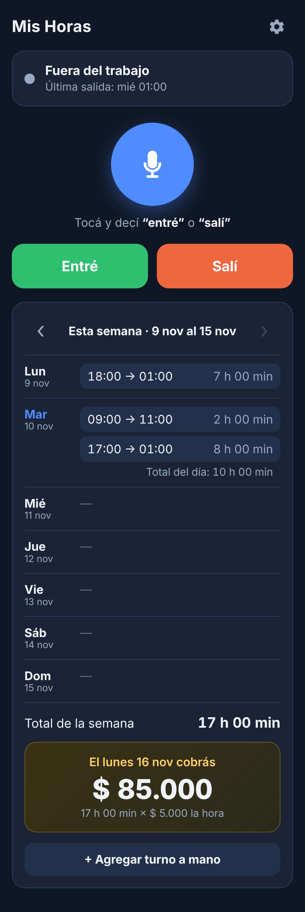

# Mis Horas

App para el celular que lleva la cuenta de las horas de trabajo.

- Tocás el micrófono y decís **"entré"** o **"salí"** (o usás los botones) y guarda la hora.
- Suma las horas de la semana, de lunes a domingo, y las multiplica por lo que cobrás por hora.
- Muestra cuánto tenés que cobrar el lunes siguiente.
- Un turno cuenta para el día en que empezó, aunque termine después de la medianoche.
- Podés tener más de un turno por día, y corregir o agregar turnos a mano.

Los datos se guardan solo en el celular. En Ajustes hay una opción para guardar y restaurar una copia.

## Instalarla en Android

1. Publicá el repositorio con GitHub Pages: **Settings → Pages → Deploy from a branch**, elegí la rama y la carpeta `/ (root)`.
2. Abrí el enlace que te da GitHub en **Chrome** desde el celular.
3. Menú de Chrome (⋮) → **Agregar a la pantalla principal / Instalar app**.

La voz necesita internet y permiso de micrófono; los botones funcionan sin conexión.

## Probarla en la computadora

```
python3 -m http.server 8000
```

y abrí `http://localhost:8000`.


